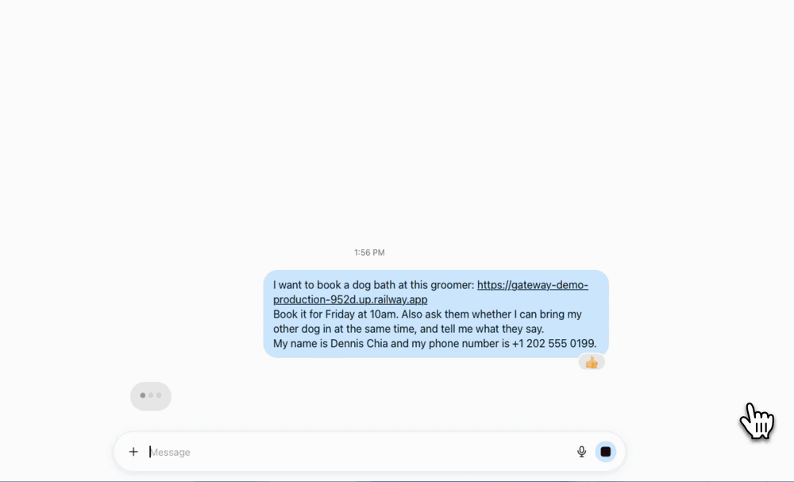

# Gateway

**Gateway** is an open-source server that lets a business deal with AI agents (e.g. Meta's Muse, Grok Bot, Dots) directly. Agents find it through `llms.txt`, then look up services and prices, book, cancel or reschedule, and leave the owner a message that they answer from Slack. It is modular: turn on only the connectors you need. Missing one? [Open an issue](https://github.com/mudroom-ai/gateway/issues/new?template=feature_request.yml).

## Quick start

Needs Node >= 22.13, git and npm (macOS or Linux; Windows via WSL), plus the system you want agents to book into: a Google Calendar shared with a service account, or a Square Appointments account. The wizard walks you through setup for either ([Google](docs/connectors/google.md), [Square](docs/connectors/square.md)).

```bash
curl -fsSL https://raw.githubusercontent.com/mudroom-ai/gateway/main/install.sh | sh
```

The installer clones into `~/gateway`, builds, and runs the setup wizard, which starts by offering to read your website to prefill its questions (optional, and it asks before sending the page text to a model), then asks what you want agents to do. It writes `config.json` and `.env`, checks access, and prints the next steps: start the server with `npm start` and check it locally. Re-run it to update; `npm run init` re-opens the wizard, which asks whether to keep, review or start over. Details, manual install and the read-it-first variant: [docs/install.md](docs/install.md).

The API (services, slots, quotes, booking, cancel, reschedule, owner messages) is described in [docs/agents.md](docs/agents.md) and served at `/openapi.json`.

## Demo



Try it with your own agent at the live playground, **[demo.mudroom.dev](https://demo.mudroom.dev)**: a pretend dog groomer whose bookings cancel themselves after an hour ([demo mode](docs/deploy.md#7-demo-mode-public-agent-playground)).

To repeat this recording with your own agent, give the local server a public HTTPS address (cloud agents can't reach `localhost`) and hand the agent the link. Needs [cloudflared](https://developers.cloudflare.com/cloudflare-one/connections/connect-networks/) (`brew install cloudflared`).

```bash
# Terminal 1: open a tunnel. It prints https://<tunnel-host>.trycloudflare.com
cloudflared tunnel --url http://localhost:3000

# Terminal 2: start Gateway and let it answer on that hostname
cd ~/gateway && ALLOWED_HOSTS=<tunnel-host>.trycloudflare.com,localhost,127.0.0.1 npm start
```

Then ask your agent (Muse, Grok or similar), filling in one of your services:

```text
Book me a <service> on Friday at 10am using
https://<tunnel-host>.trycloudflare.com
My name is <name> and my phone number is <phone>.
```

The agent reads the instructions served there (the same page as `/llms.txt`), checks slots, gets a quote and books, and the event shows up in your calendar. The tunnel hostname changes on every run, and ChatGPT refuses `trycloudflare.com` links, so use a real domain for anything longer-lived ([docs/deploy.md §3](docs/deploy.md#3-expose-it-over-https-with-cloudflared)).

## Connectors

Connectors come in three modules. A **Store** is a booking platform that owns its slots and prices. A **Calendar** is a plain calendar that Gateway builds slots and prices on. **Communication** is how the owner hears from Gateway, and it works beside either of the others.

| System | Module | Doc |
|---|---|---|
| Google Calendar (service account) | Calendar: Gateway builds slots and prices from your rules | [docs/connectors/google.md](docs/connectors/google.md) |
| Square Appointments | Store: Square's catalog, prices and policies; buyer-level access, no payments | [docs/connectors/square.md](docs/connectors/square.md) |
| GlossGenius (experimental) | Store, shadow mode: services, prices and open times read from the public booking page; bookings go to a shared Google Calendar plus a text to the merchant, who adds them to GlossGenius | [docs/connectors/glossgenius.md](docs/connectors/glossgenius.md) |
| Twilio SMS (optional) | Communication, notices only: texts the merchant about every agent booking, cancel and reschedule | [docs/connectors/twilio.md](docs/connectors/twilio.md) |
| Slack (optional) | Communication, two-way: agent messages land in a Slack channel and the owner answers by typing in the thread; booking notices too. Socket Mode, no inbound URL | [docs/connectors/slack.md](docs/connectors/slack.md) |
| WhatsApp (optional) | Communication, two-way: agent messages land on the owner's WhatsApp and the owner answers by swipe-replying; booking notices too. Meta Cloud API, needs a public URL for Meta's webhook | [docs/connectors/whatsapp.md](docs/connectors/whatsapp.md) |

Adding a connector: [docs/connectors/README.md](docs/connectors/README.md). Contributing: [CONTRIBUTING.md](CONTRIBUTING.md).

## Docs

- [docs/install.md](docs/install.md): installer, wizard, manual install, updating
- [docs/configuration.md](docs/configuration.md): `config.json` and every env var
- [docs/deploy.md](docs/deploy.md): Docker, HTTPS tunnel, hosting, operations
- [docs/agents.md](docs/agents.md): `llms.txt`, `openapi.json`, HTTP smoke test, booking semantics
- [docs/errors.md](docs/errors.md), [docs/architecture.md](docs/architecture.md), [docs/README.md](docs/README.md) (index)

## License

Apache-2.0. See `LICENSE`.
