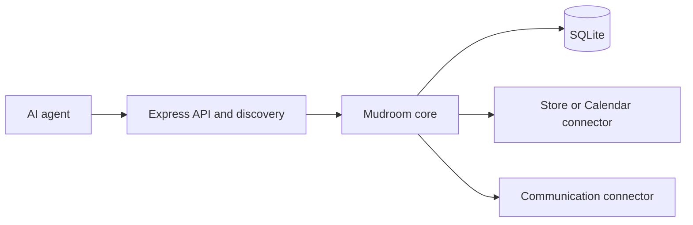

# Architecture notes

Mudroom runs **one process per merchant**, exposes an HTTP API, and stores local state in SQLite. Connectors handle booking systems and owner communication.

## Shape

| Component | Responsibility |
| --- | --- |
| Express | Hosts `/api`, `/`, `/llms.txt`, `/.well-known/llms.txt`, and `/openapi.json` |
| Middleware | Validates `Host`, checks optional bearer keys, applies per-IP and per-contact limits, and handles the idempotency header |
| SQLite | Stores quotes, bookings, idempotency keys, the booking log, message threads, and the owner outbox in one file |

**Deploy with a persistent volume and exactly one replica.** See [deployment requirements](deploy.md).

## Connectors

Three modules share interfaces defined in `src/connectors/types.ts`:

| Module | Interface | Responsibility |
| --- | --- | --- |
| Calendar | `CalendarConnector` | Supplies busy intervals and events. Mudroom builds slots and prices using hours, buffers, blackout days, discounts, and a price floor. `calendar.ts` adapts it to a `BookingConnector`. |
| Store | `BookingConnector` | Supplies slots and prices and handles booking, cancellation, and rescheduling. Bypasses Mudroom's rules engine. |
| Communication | `CommunicationConnector` | Works beside either booking module. All providers implement `notify`; two-way providers also implement optional thread members. |

Connectors throw `ConnectorError`; the core shapes [HTTP errors](errors.md#connector-errors). See the [connector registry and development checklist](connectors/README.md).

### Booking notifications

`src/book.ts` and `src/cancel.ts` send one owner notification after each successful booking, cancellation, or reschedule. `src/notify/owner.ts` builds the text. **Delivery failures are logged and never change the booking outcome.**

Shadow-mode connectors such as GlossGenius read platform data but write bookings to Google Calendar. Their notices ask the merchant to enter the change manually; without SMS, they fall back to `logOwnerChannel`.

### Owner messages

`src/messages.ts` handles `leave_message`, `get_thread`, `follow_up`, and `close_thread`, independently of the channel.

| Channel capability | Message flow |
| --- | --- |
| Two-way (Slack, WhatsApp) | Creates a channel thread (WhatsApp: one message the owner quotes). Replies reach the core through its registered `onOwnerMessage` handler; WhatsApp's arrive on a webhook the server mounts outside `/api`. |
| Notify-only (Twilio) | Sends through `notify`; the owner contacts the customer directly. |
| No channel | Messaging routes are absent. |

Threads close when the agent closes them, `book.ts` books for the same contact, or the sweep closes idle threads. The owner does not need to close them.

Persistence, retries, and duplicate prevention

Threads, messages, outbox entries, and idempotency rows share the SQLite file. The core **persists first, then sends**.

- **Transient failure:** keeps the message queued. A sweep runs every 30 seconds, with 5 retries spaced from 30 seconds to 8 minutes.
- **Permanent failure:** removes the stored data and returns `channel_unavailable`.
- **Uncertain delivery:** reconciles before retrying, as in `book.ts`. Each outbox row has a dedupe key attached to the channel post. Every attempt after the first calls `findPosted` before posting; if that lookup fails, nothing is posted.

Reconciliation prevents duplicate posts after a timeout or a crash between provider acceptance and local recording.

Recovering owner replies after downtime

The channel recovers missed replies. The core supplies open thread references and a durable cursor through `ChannelContext`; the channel fetches missed replies on every connection.

## No MCP

Mudroom uses plain HTTP because its target agents (Meta's Muse and Grok) cannot install an MCP server. Agents discover the API through `/llms.txt`.

`src/middleware/hosts.ts` provides DNS-rebinding protection through `Host` validation and `ALLOWED_HOSTS`. It replaces the MCP SDK's `createMcpExpressApp` validation and fails closed for specific non-loopback bind addresses.
